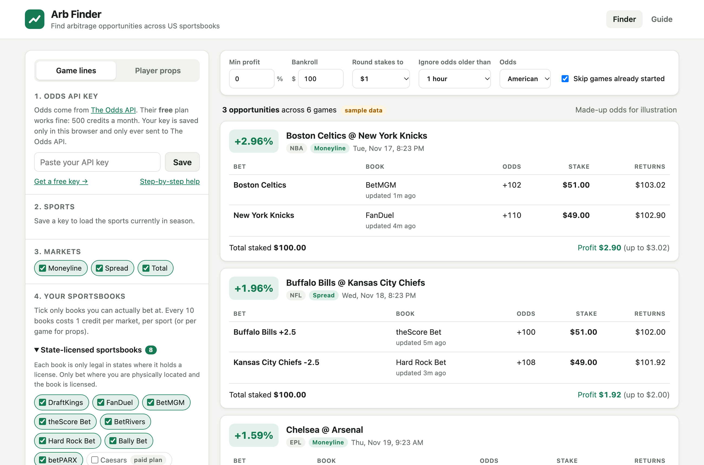
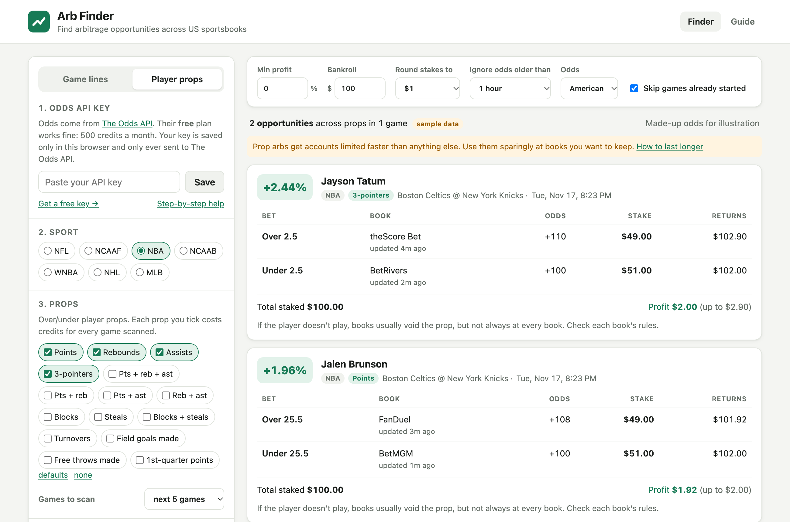

::: {.hero-buttons}
[Open the app](https://rkirbs.github.io/arb-finder/){.btn .btn-primary}
[Try it with sample data](https://rkirbs.github.io/arb-finder/?demo=1){.btn .btn-outline-primary}
[Read the user guide](https://rkirbs.github.io/arb-finder/guide.html){.btn .btn-outline-primary}
[View the code on GitHub](https://github.com/RKirbs/arb-finder){.btn .btn-outline-primary}
:::

## The question

Sportsbooks price the same games independently. When two books disagree by enough, betting every outcome at the best available prices pays back more than it costs, whichever side wins. That's an arbitrage. Tools that find these usually charge a monthly subscription. I wanted to build one that anyone can use for free, that costs nothing to run, and that explains the math and the risks honestly.

## What I did

- **Chose a data source that keeps it free and within the rules.**
  - I ruled out scraping sportsbooks, which breaks their terms and breaks whenever a site changes.
  - I chose The Odds API instead. Its terms allow its data to be displayed in a website.
  - I designed the app around *bring your own key*. Each visitor uses their own free key (500 credits a month), which is stored only in their browser. That means no server, no shared quota and no hosting cost.
- **Wrote the arbitrage engine** as pure, testable JavaScript.
  - It only combines outcomes that together cover every possible result:
    - 2- and 3-way moneylines;
    - spreads paired at exactly opposite numbers;
    - totals at the same number;
    - player props matched on the same player, stat and line.
  - It takes the best price for each side across the books the user selects. It flags any line where the implied probabilities add up to less than 100%.
  - It sizes the stakes so every outcome pays back the same amount. Stakes can be rounded, in which case it reports the worst-case profit after rounding.
- **Built in guards against false positives**, the main weakness of arbitrage tools. Users can filter out stale prices (using each market's last-update time) and games already in progress. Any edge above 10% gets a warning, since that is usually a stale line or a pricing error.
- **Added player props** through the API's per-game endpoint. Props are billed per game, so the app shows a live credit estimate (games × props × groups of 10 books) before every scan. The guide explains when a paid data plan makes sense.
- **Added a "cover bet" finder.** It measures each sportsbook's own margin on its two-way lines and suggests the cheapest ordinary bets on popular games. The expected cost of a bet is about stake × (1 − 1/Σ 1/odds). It uses data already loaded, so it costs no API credits.
- **Wrote a 15-section user guide** for people new to arbitrage. It covers:
  - a worked example;
  - getting and entering a free API key;
  - reading a result and placing bets safely;
  - budgeting credits;
  - the risks;
  - an FAQ and a disclaimer.
- **Reviewed it for legal and policy issues before release:**
  - checked the data provider's terms and GitHub's acceptable-use policy;
  - removed offshore books that aren't licensed in any US state, and prediction markets that aren't offered to US users;
  - labelled sweepstakes apps whose legality varies by state;
  - replaced "guaranteed profit" wording;
  - updated the problem-gambling helpline to the current national number, 1-800-MY-RESET, after finding that 1-800-GAMBLER had been retired as the national line.
- **Tested and shipped it.**
  - 23 unit tests cover the math.
  - 30 end-to-end checks run the real app against a simulated API, checking the exact requests sent, the credit estimates and the rendered results.
  - A Content-Security-Policy limits the page to talking only to the odds API, which protects users' keys.
  - It's hosted on GitHub Pages.

## What I learned

- **Odds are probabilities, and that one idea does most of the work.** Converting prices to implied probabilities turns a book's margin and an arbitrage into the same calculation, run in opposite directions. The app uses it both to find arbs and to price cover bets.
- **The hard part isn't the formula. It's making sure two prices are really the same bet.** Most of the engine's logic is about matching identical outcomes across books and discarding stale or one-sided lines, because a false arb costs a user real money.
- **Costs shape the design.** The API bills per sport for game lines but per game for props. That drove the up-front credit estimate, defaults that keep each request at one credit per market, and caching so that re-filtering results is free.
- **Releasing something publicly means checking more than the code:** data licensing, platform rules, state-by-state legality, and responsible-gambling messaging.

{fig-alt="Screenshot of Arb Finder showing settings on the left and arbitrage result cards on the right, each listing the bets, sportsbooks, odds, stakes and returns."}

{fig-alt="Screenshot of Arb Finder in player-prop mode showing prop selections on the left and two prop arbitrage cards for Jayson Tatum 3-pointers and Jalen Brunson points."}

**Tools:** JavaScript (ES modules), HTML, CSS, The Odds API (REST, v4), headless Chrome for automated testing, Git/GitHub, GitHub Pages.
