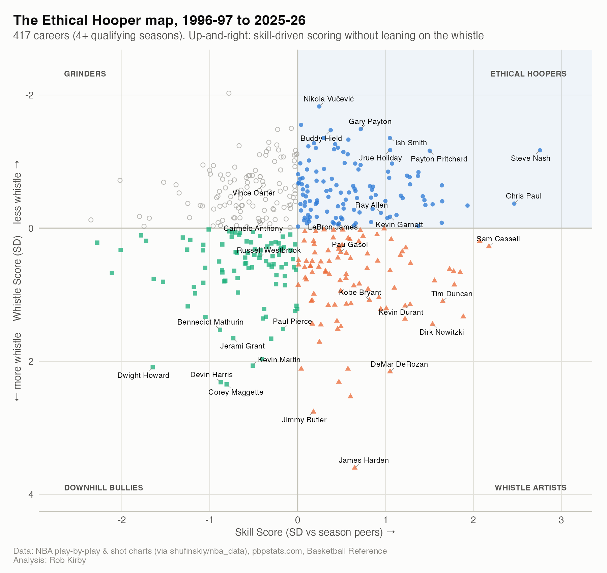
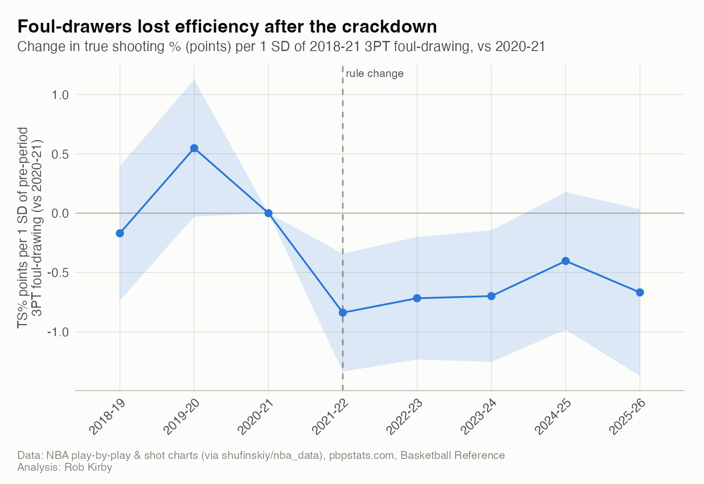

::: {.hero-buttons}
[Read the full report](https://rkirbs.github.io/ethical-hooper-index/){.btn .btn-primary}
[Search any player](https://rkirbs.github.io/ethical-hooper-index/player.html){.btn .btn-outline-primary}
[View the code on GitHub](https://github.com/RKirbs/ethical-hooper-index){.btn .btn-outline-primary}
:::

## The question

"Ethical hooper" is basketball slang for a player who scores through pure skill (clean footwork, natural shot-making, smooth handles) rather than foul-baiting, flopping, or jumping into defenders to draw a whistle. I wanted to know whether that idea could be measured. Who are the most and least "ethical" scorers since 1996-97? And when the NBA told referees in 2021-22 to stop rewarding "non-basketball moves," did it hit the players my index had flagged?

## What I did

- **Built the dataset from 30 seasons of NBA play-by-play and shot charts** (1996-97 to 2025-26, regular season and playoffs): 6.3 million shots and every foul and free throw, linked to official minutes and positions from Basketball Reference.
- **Validated it against independent sources.** My counts of shooting fouls drawn, and-ones, offensive fouls and assisted shots match Basketball Reference's own tables (correlations of 0.998 or higher), and attempts, free throws and turnovers match official totals within ±2 for every 1,000-minute season. The checks also caught real problems: 16 games missing from the source archive, a 2025-26 change in how the NBA logs end-of-quarter heaves, and Hall of Famers' playoff seasons filed under a different name.
- **Trained an expected-field-goal model** (xgboost) on shot location, distance, shot type, game clock and season, but never on who took the shot. It beat a zone-average baseline on a held-out season (log-loss 0.639 vs. 0.657) and is closely calibrated.
- **Designed the index** from eight components on two axes. **Skill:** shot-making above expected, self-created makes, shot difficulty and clean footwork. **Whistle:** free throws beyond what a player's shot diet predicts, three-point fouls drawn, free-throw share of points, and and-ones on jumpers. I used empirical-Bayes shrinkage so small samples don't create fake extremes, and standardized everything within season so eras compare fairly.
- **Ran a difference-in-differences and event study** of the 2021-22 rule change, with a placebo rule date and a separate treatment window to rule out regression to the mean.
- **Published it** as an eight-page Quarto website with searchable rankings and an interactive player lookup.

## What I found

- **Steve Nash is the most ethical hooper of the last 30 years** (career score 87.7 out of 100), followed by Payton Pritchard, Ish Smith, Nikola Vučević and Chris Paul. **James Harden ranks last** of 417 qualifying careers (10.7).
- **The style is a real, lasting trait:** a player's score correlates 0.74 with the next season's, and the rankings barely change under alternative weightings (rank correlations of 0.89 to 0.99).
- **The crackdown worked league-wide:** three-point shooting fouls fell from 1.42 to 1.08 per 100 attempts in one season. The apparent extra drop for prior foul-drawers turned out to be mostly regression to the mean, since a fake "placebo" rule date shows a similar decline.
- **But the index predicted who lost efficiency:** players with higher pre-rule Whistle Scores lost 0.38 points of true shooting per standard deviation afterward (p = 0.049), while the placebo showed nothing (p = 0.81).

{fig-alt="Scatter plot of 417 NBA careers with Skill Score on the x-axis and Whistle Score on the y-axis; Steve Nash sits alone at the top right and James Harden at the bottom."}

{fig-alt="Event study line chart: change in true shooting percentage by season relative to 2020-21, flat before 2021-22 and lower afterward."}

**Tools:** R (data.table, arrow, xgboost, fixest, ggplot2, gt, reactable), Quarto with Observable JS, renv, Git/GitHub.
