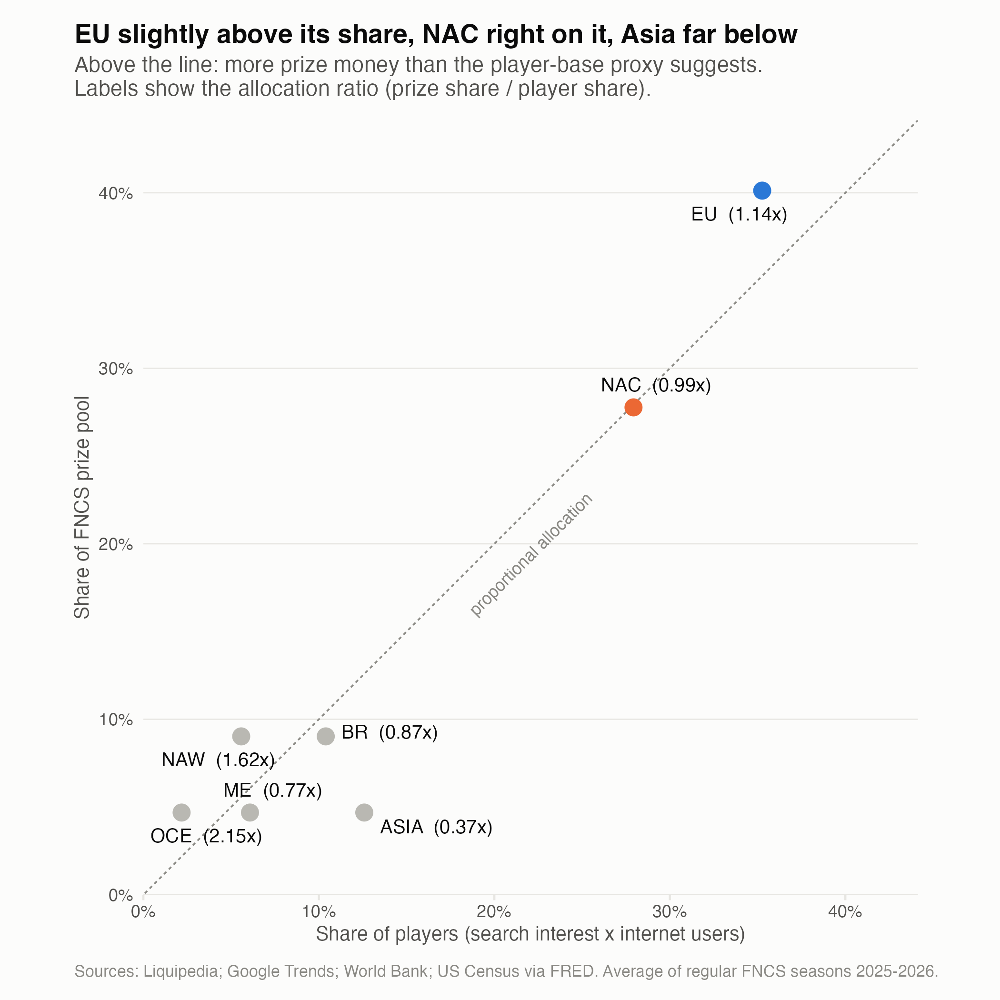
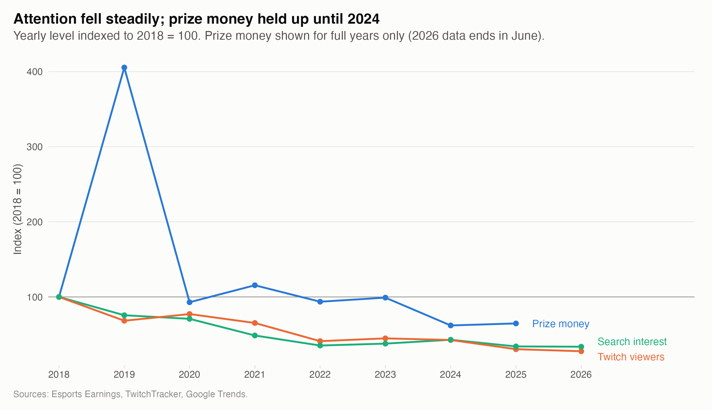

::: {.hero-buttons}
[Read the full report](https://rkirbs.github.io/fortnite-esports-analysis/){.btn .btn-primary}
[View the code on GitHub](https://github.com/RKirbs/fortnite-esports-analysis){.btn .btn-outline-primary}
[Project summary (PDF)](https://rkirbs.github.io/fortnite-esports-analysis/report/project-summary.pdf){.btn .btn-outline-primary}
:::

## The question

Fortnite's developer, Epic Games, runs one of the largest competitive gaming circuits in the world. I asked four questions about it: Does prize money move with public interest in the game? Do major tournaments draw more attention? As prize money changed, did more players earn a share or did it concentrate at the top? And is prize money split between world regions in proportion to how many people play there?

## What I did

- **Collected the data myself** from seven sources: $209.1M of prize money across 2,674 tournaments and 11,443 players, 113 months of Twitch viewership, weekly Google search interest, World Bank and Census data, and 26 seasons of regional championship prize pools. Every request followed each site's rules on automated access, with delays between requests.
- **Validated everything.** Automated checks reconcile my totals with the source's own published figures. They caught a $2.0M event missing from the source's listings and multi-game events that would have double counted money.
- **Analysed it four ways:** time series comparisons (in levels and in changes, to avoid spurious correlation), an event study with season controls and Newey-West standard errors, inequality measures (Gini coefficients, Lorenz curves, top-N shares), and a regional allocation analysis tested under three different player-base proxies.
- **Wrote it up** as a reproducible Quarto report that explains the game and every method for non-specialist readers, with the code folded under each result.

## What I found

- Prize money and public attention follow different paths: viewership and search interest fell steadily after 2018 while prize money held up until 2024, and month-to-month changes are essentially uncorrelated.
- Tournaments barely move mainstream attention (about +3% in a finals week) compared with new game seasons (about +28%).
- From 2019 to 2025 prize money fell 84% while the number of players earning anything fell only 32%, and the top 100 earners' share rose from 44% to 65%.
- A common belief among players, that Europe is underpaid relative to North America Central, is **not** supported: Europe receives 1.14x its share of players and NA Central 0.99x. The largest gaps are in smaller regions.

{fig-alt="Scatter plot of each region's share of prize money against its share of players."}

{fig-alt="Line chart of prize money, Twitch viewers and search interest indexed to 2018."}

**Tools:** R (tidyverse, httr2, rvest, gtrendsR, sandwich, ineq), Quarto, Git/GitHub.
