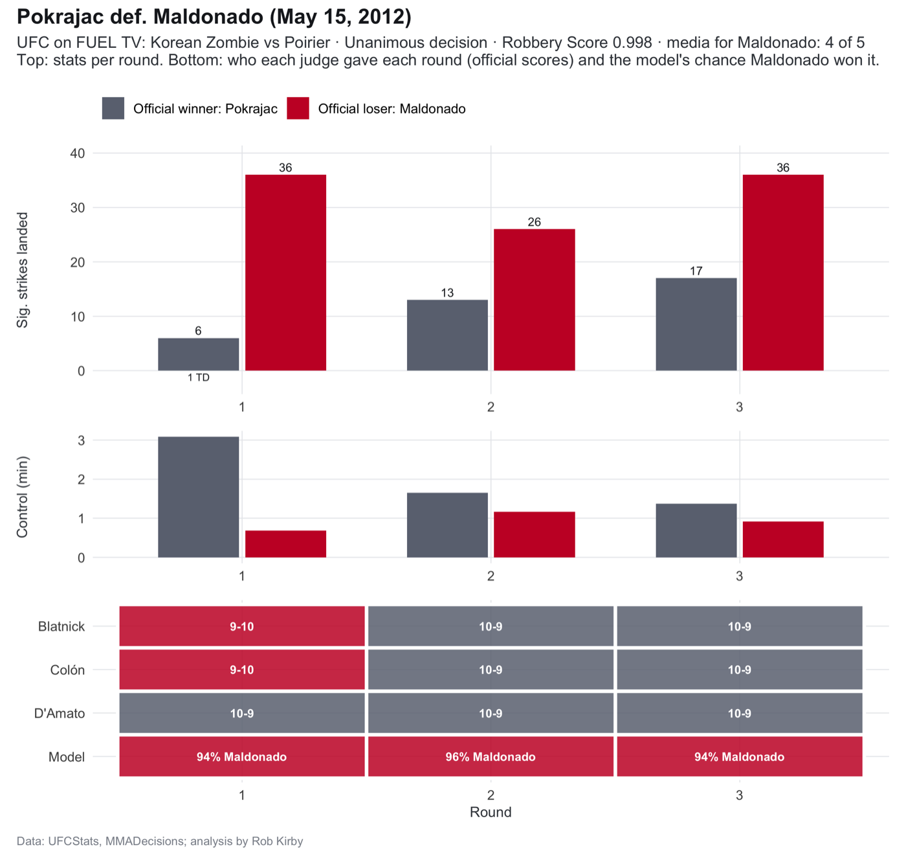
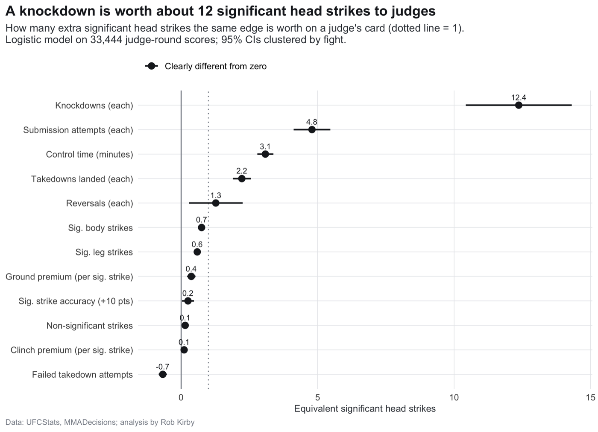
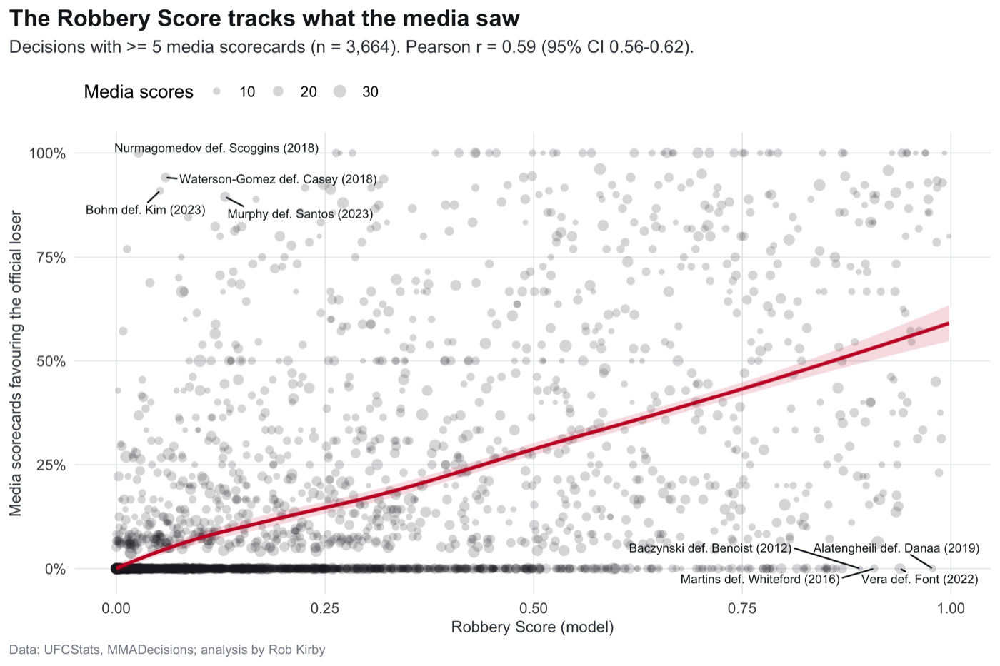

::: {.hero-buttons}
[Read the full report](https://rkirbs.github.io/ufc-robbery-detector/){.btn .btn-primary}
[Browse the leaderboard](https://rkirbs.github.io/ufc-robbery-detector/leaderboard.html){.btn .btn-outline-primary}
[View the code on GitHub](https://github.com/RKirbs/ufc-robbery-detector){.btn .btn-outline-primary}
:::

## The question

Every fight fan has a list of "robberies": decisions they're sure went to the wrong fighter. I wanted to test that claim with data. Given what actually happened in each round (strikes, knockdowns, takedowns, control time), how likely was the declared winner to get the decision from real judges? I call one minus that probability the **Robbery Score**. It measures disagreement between the statistics and the result. It is never an accusation of judge misconduct, because statistics can't see everything judges can.

## What I did

- **Built and linked three data sources:**
  - round-by-round statistics for every UFC fight, from UFCStats;
  - every judge's round-by-round scorecard plus 51,355 media scorecards, from MMADecisions, collected with the site owner's permission;
  - historical betting lines from BestFightOdds.

  All 4,109 decisions from 2001 to November 2026 were linked across the sources. I checked the robots.txt and terms of every site, paused between requests and cached every page.
- **Found and fixed two data problems before reporting anything:**
  - **Point deductions:** MMADecisions round scores already include them, so a 10-9 round with a point taken away looked like a 9-9 "draw" (109 deductions in 105 fights).
  - **Fighter order:** UFCStats lists the *winner* first, not the red corner, for fights before March 2010.
- **Trained a round model** on 33,444 real judge round scores. It predicts which fighter a judge gives each round from that round's statistics alone. Training rounds were mirrored so the model can't learn "the red corner wins". I compared logistic regression, glmnet and xgboost (tidymodels) with grouped cross-validation by fight and a 2020–2026 time-based test. Every model cut log-loss by about 30% against a "whoever landed more strikes wins" baseline (0.38 vs. 0.55).
- **Simulated 10,000 sets of three correlated judges for every fight.**
  - The correlation between judges was estimated by maximum likelihood. It reproduces how often real judges split on a round: 22.0% observed vs. 22.2% predicted, where independent judges would split 35.9% of the time.
  - The simulation also models 10-8 rounds, 10-10 rounds and point deductions.
  - It uses out-of-fold predictions, so no fight's own scorecards inform its own score.
- **Validated the score against independent evidence:** media scorecards the model never sees, a hand-picked list of widely debated decisions, calibration checks, and a sensitivity test with a different model (rank correlation 0.987).
- **Studied the judges** with mixed models that have judge random effects. I estimated red-corner and betting-favourite effects, and tested whether the 2017 Unified Rules scoring criteria changed what judges reward.
- **Published it** as a seven-page Quarto website with a searchable leaderboard and round-by-round breakdowns of featured fights. The whole thing is a reproducible `targets` pipeline with `renv`-pinned packages, and no number in the write-up is typed by hand.

## What I found

- **About 1 in 18 decisions is a statistical "robbery".** 225 of 4,049 decisions (5.6%) have a Robbery Score of at least 0.75. The highest scores belong to Igor Pokrajac vs. Fabio Maldonado (2012) and Leonard Garcia vs. Nam Phan (2010).
- **The score lines up with people who watched the fights.** It correlates with the share of media scoring the fight for the loser at r = 0.59. The stats-only model agrees with the media majority 87.7% of the time, close to the official result's 89.8%. 11 of 13 widely debated decisions rank in the top 16%.
- **What judges reward,** measured in significant head strikes:
  - a knockdown is worth about 12;
  - a submission attempt about 5;
  - a minute of control about 3;
  - a takedown about 2;
  - a failed takedown attempt *costs* about 0.7.
- **Judges lean slightly toward the red corner and the betting favourite.** On a round the stats call 50/50, the red corner gets about 4.7 points more, and a −300 favourite about 6.5 points more. Adjusted for how hard their fights were to score, individual judges agree with the stats at very similar rates.
- **The 2017 criteria changed what judges reward, but not how often decisions go "wrong".** A knockdown rose from about 9 to 15 head strikes and a takedown fell from 2.7 to 1.9 (joint test p = 0.0006). The Robbery-tier rate showed no clear change.

{fig-alt="Three-panel chart for Pokrajac vs. Maldonado: significant strikes per round, control time per round, and a grid of each judge's round scores next to the model's round probabilities."}

{fig-alt="Dot-and-interval chart of how many significant head strikes each statistic is worth on a judge's card, led by knockdowns at about 12."}

{fig-alt="Scatter plot of Robbery Score against the share of media members who scored the fight for the official loser, showing a clear positive relationship."}

**Tools:** R (targets, tidymodels, xgboost, glmnet, lme4, sandwich, shapviz, rvest/httr2, arrow, ggplot2, patchwork, gt, reactable), Quarto, renv, Git/GitHub.
